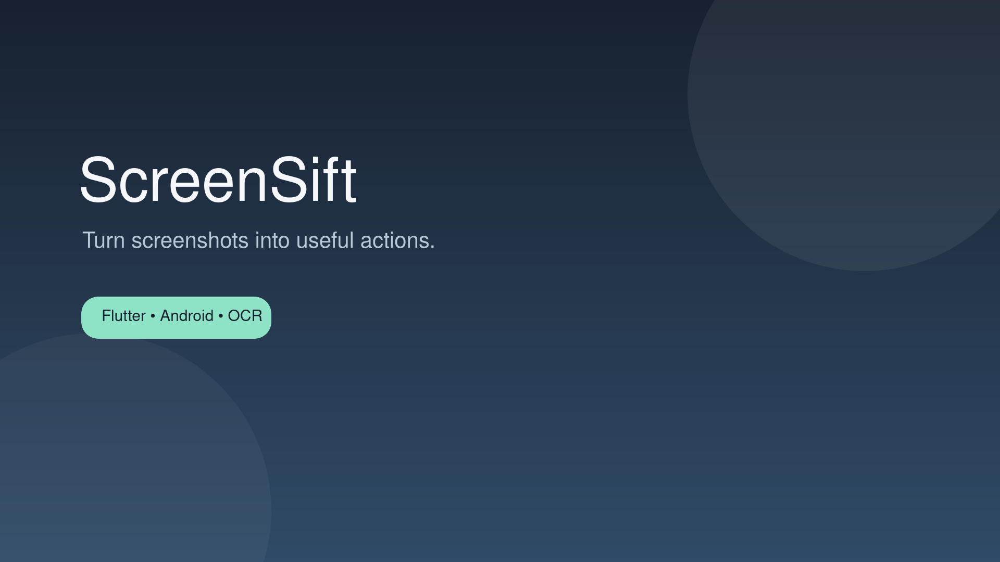

# ScreenSift

ScreenSift is a Flutter Android app that turns screenshots into useful, searchable actions. It watches for new screenshots, extracts their text, classifies each capture, and keeps the result organized in one focused inbox.



## Features

- Automatic screenshot detection on Android
- On-device OCR with Google ML Kit
- Local rule-based extraction with optional remote extraction fallback
- Categorization for links, notes, reminders, events, contacts, and more
- Action shortcuts such as opening links, creating calendar events, and saving notes
- Local notifications and a searchable capture vault
- Offline-first Lottie loading states and empty states

## Tech stack

- Flutter and Dart
- Android native services with Kotlin
- Google ML Kit Text Recognition
- SharedPreferences for local settings and persistence
- Dio and HTTP for network requests
- Lottie for animations

## Getting started

### Prerequisites

- Flutter SDK with Dart 3.12 or newer
- Android Studio or an Android SDK installation
- An Android device or emulator running Android 6.0 (API 23) or newer

### Run locally

```bash
flutter pub get
flutter run
```

To check the project:

```bash
flutter analyze
flutter test
```

## Project structure

```text
lib/
├── core/                 # Theme, motion, and shared widgets
├── data/
│   ├── datasources/      # Native screenshot and settings access
│   ├── models/           # Capture, category, intent, and status models
│   ├── repositories/     # Capture orchestration
│   └── services/         # OCR, extraction, notifications, and actions
└── main.dart             # Application entry point
android/                  # Kotlin screenshot watcher and Android bridge
assets/lottie/            # Bundled animation assets
```

## How it works

1. The Android screenshot watcher detects a new capture.
2. ScreenSift reads the image and extracts text locally with ML Kit.
3. The extractor identifies the likely category and useful actions.
4. The capture is saved to the vault and an optional notification presents the next action.

## License

This project is currently distributed without a public license. Add a license before accepting external contributions.
